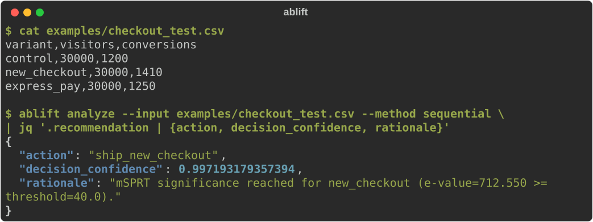

# ablift

[](https://pypi.org/project/ablift/)
[](https://github.com/Fabio-RibeiroB/ablift/actions/workflows/ci.yml)
[](https://pypi.org/project/ablift/)
[](https://github.com/Fabio-RibeiroB/ablift/blob/main/LICENSE)
[](https://github.com/astral-sh/ruff)
[](https://github.com/astral-sh/uv)

**Turn A/B test numbers into a ship / don't-ship decision from the command line, with JSON output an AI agent can act on.**



> **Alpha.** The statistics are tested against reference implementations, but the CLI and output format may still change before 1.0.

## Why ablift

- **Decisions, not just p-values.** Every analysis ends in an action (`ship_<variant>`, `continue_collecting_data`, `do_not_ship`, `stop_and_rollback`, `investigate_data_quality`) with a confidence score and risk flags.
- **Look at results as often as you like.** Sequential mode uses mSPRT with always-valid confidence intervals, so checking daily does not inflate false positives.
- **Catches bad data before you ship.** Sample ratio mismatch, sparse conversion counts, whale-dominated revenue and pre-experiment covariate imbalance are all flagged.
- **Built for agents and pipelines.** JSON in, JSON out, a published JSON Schema, stdin support, clean errors and stable exit codes.

## Install

`ablift` is currently published as a pre-release, so allow pre-releases when installing:

```bash
uv tool install --prerelease=allow ablift   # or: pip install --pre ablift
```

## Quickstart

<!-- docs-test: run -->
```bash
# Analyze a starter JSON experiment (Bayesian by default)
ablift example-input | ablift analyze --input -

# Pipe in a CSV and run a sequential test you can re-check every day
printf 'variant,visitors,conversions\ncontrol,30000,1200\nnew_checkout,30000,1410\n' \
  | ablift analyze --input - --input-format csv --method sequential

# Plan how long a test needs to run
ablift duration --baseline-rate 0.04 --relative-mde 0.05 --daily-traffic 50000

# Power analysis: what lift can 10,000 users per variant detect?
ablift power --baseline-rate 0.08 --n-per-variant 10000
```

Add `--report report.md` to any `analyze` run for a human-readable Markdown summary.

## What it supports

| Method (`--method`) | Conversion rate | ARPU (revenue per visitor) | Ratio (e.g. CTR, AOV) |
|---|:---:|:---:|:---:|
| `bayesian`: probability to beat control, expected loss | ✅ | ✅ | ✅ |
| `sequential`: mSPRT, always-valid, safe to peek | ✅ | ✅ | ✅ |
| `fixed`: z / Welch t / Fisher exact, one planned look | ✅ | ✅ | ✅ |

Also included:

- **A/B/n tests** with Bonferroni correction, or joint `probability_best` in Bayesian mode
- **CUPED variance reduction** using a pre-experiment covariate, often cutting required traffic substantially
- **Guardrail and secondary metrics** evaluated per variant
- **SRM checks** with custom traffic splits (`--expected-split 90,10`)
- **Heavy-tailed revenue handling** with pooled winsorization and bootstrap intervals
- **Duration planning and power analysis** for conversion rate and ARPU: sample size and days (`duration`), or power and minimum detectable effect for a given sample size (`power`)
- **Input** from JSON, CSV, XLSX or stdin, with **output** as JSON and an optional Markdown report

## Commands

| Command | What it does |
|---|---|
| `ablift analyze` | Analyze an experiment from JSON, CSV, XLSX or stdin |
| `ablift duration` | Estimate the sample size and days a test needs |
| `ablift power` | Power for a given sample size, or the smallest lift it can detect |
| `ablift schema` | Print the JSON Schema for inputs and outputs |
| `ablift example-input` | Print a starter JSON input |
| `ablift doctor` | Check the environment (`--strict` fails CI on problems, `--json-output` for agents) |

Run `ablift <command> --help` for every option.

## Documentation

- [Inputs](https://github.com/Fabio-RibeiroB/ablift/blob/main/docs/inputs.md): choosing a metric, the JSON contract, CSV/XLSX layouts, stdin and `pyproject.toml` defaults
- [Reference SQL](https://github.com/Fabio-RibeiroB/ablift/blob/main/docs/sql.md): ANSI SQL query for turning raw exposure and event tables into aggregated CSV or CUPED JSON input
- [Statistical methods](https://github.com/Fabio-RibeiroB/ablift/blob/main/docs/methods.md): what each method computes and how multiple variants are handled
- [Duration and power](https://github.com/Fabio-RibeiroB/ablift/blob/main/docs/duration.md): sample size, runtime, power and minimum detectable effect
- [Agents and automation](https://github.com/Fabio-RibeiroB/ablift/blob/main/docs/agents.md): schemas, a step-by-step playbook, exit codes and every output field
- [Changelog](https://github.com/Fabio-RibeiroB/ablift/blob/main/CHANGELOG.md)

## Limitations

- Aggregated ARPU inputs cannot be winsorized after aggregation (only a CV-based `heavy_tailed_revenue` warning is emitted); pass row-level revenue with `--winsorize Q` (and optionally `--bootstrap-samples N`) when whale outliers are present.
- mSPRT guarantees assume you re-run the analysis on cumulative data as it arrives. The tool keeps no state between looks.
- CUPED variance reduction currently supports `conversion_rate` and `arpu` primary metrics (not `ratio`).

## Development

```bash
uv sync                  # installs the test and lint groups
uv run pytest            # test suite, including the docs checks
make lint                # ruff and ty
make demo                # run every bundled example into examples/out/
make docs                # re-render docs/demo.svg after changing CLI output
```

See [CONTRIBUTING.md](https://github.com/Fabio-RibeiroB/ablift/blob/main/CONTRIBUTING.md) for how changes are checked and released.

## License

MIT. See [LICENSE](https://github.com/Fabio-RibeiroB/ablift/blob/main/LICENSE).
